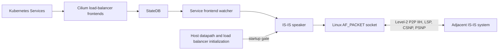

# Cilium IS-IS Control Plane

The IS-IS Control Plane allows Cilium to advertise eligible IP addresses of
Kubernetes Services of type `LoadBalancer` to an external network using the
[IS-IS routing protocol][]. IS-IS carries each LoadBalancer IP as an IPv4 `/32`
reachability in a Level-2 LSP using Extended IP Reachability (TLV 135). External
routers that learn and install these routes can use them to reach the Services
from outside the cluster. The control plane does not program the
[datapath][] or install routes learned from IS-IS; it is not intended to provide
reachability within the cluster or act as a transit router.

[IS-IS routing protocol]: https://datatracker.ietf.org/doc/html/rfc1195
[datapath]: https://docs.cilium.io/en/latest/network/ebpf/

## Usage

The experimental IS-IS Control Plane is disabled by default. Enable it with the
following agent flags:

```text
--enable-isis-control-plane=true
--isis-interface=eth0
--isis-net=49.0001.0000.0000.00c1.00
```

The speaker waits for the host datapath and load balancer to initialize before
opening its IS-IS packet socket. The packet socket implementation is supported
on Linux.

## Configuration

`isis-interface` names the single host interface used for the point-to-point
circuit. `isis-net` is the local dotted-hexadecimal Network Entity Title (NET),
including its area address, six-octet System ID, and NSEL `00`. The System ID
must be stable and unique in the IS-IS domain.

The current configuration supports one IPv4 Level-2 point-to-point circuit and
one neighbor. There are no configuration options for additional instances,
interfaces, levels, or peers.

## Architecture

The IS-IS Control Plane is an agent-side module. It consists of a Service
frontend watcher and a single protocol speaker. It does not use an external
routing daemon or add a Kubernetes API resource.

### Agent-Side Architecture

#### Component Diagram



#### Service Frontend Watcher

The watcher reads the current StateDB frontend table and derives the complete
desired set of Service LoadBalancer IPs. IS-IS advertises only each IP prefix,
not a Service-specific object. A frontend must be a reconciled external
LoadBalancer frontend in the local cluster, have an IPv4 global-unicast address,
use `externalTrafficPolicy: Cluster`, and belong to a Service with the
annotation `isis.cilium.io/advertise: "true"`.

Multiple frontends for the same IP are deduplicated. Every selected distinct
Service LoadBalancer IP is advertised while the complete self-originated LSP
fits within the interface PDU budget. If the set does not fit, the speaker
withdraws all Service routes. When a selected frontend is removed or becomes
ineligible, the speaker updates its self-originated LSP to omit that prefix.

#### Speaker

The speaker sends and receives IS-IS packets on the configured interface and
forms a three-way Level-2 point-to-point adjacency with one neighbor. It
originates an overloaded Level-2 LSP containing the local IPv4 interface
address, the neighbor reachability when the adjacency is up, and the selected
Service LoadBalancer IPs as Extended IP Reachability.

The speaker maintains a bounded LSDB and handles CSNP/PSNP synchronization,
acknowledgements, retransmissions, LSP refresh, expiry, and purge. Received
LSPs are retained for synchronization. The package does not run SPF, select
paths, install learned routes, or program Cilium's host FIB.

##### Scope and Limitations

The speaker supports IPv4 and Level-2 point-to-point operation only. It does not
implement Level-1, L1/L2 behavior, LAN circuits, DIS election, pseudonode LSP
origination, or multiple peers. IPv6 support, including advertising IPv6 Service
addresses, is out of scope. IS-IS authentication is not supported. The overload
bit prevents other routers from using Cilium as a transit node.

The speaker's protocol state is recreated when its job restarts. The Service
watcher sends the current Service IP set at startup and when the frontend table
changes, but it does not currently replay an unchanged set solely because the
speaker job restarted. This restart path must be addressed before relying on
independent speaker-job recovery to restore an advertisement.
